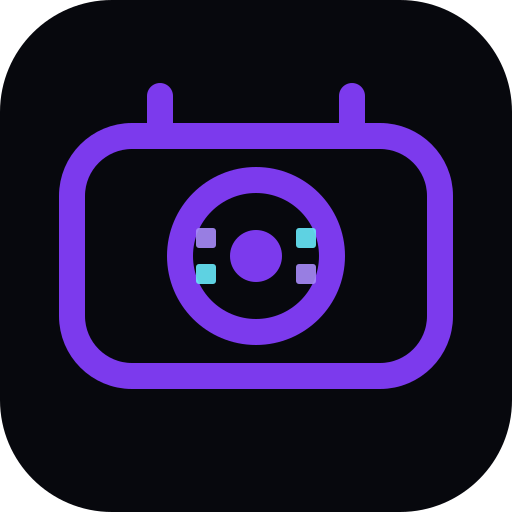

<div align="center">



# BlinkCode AI

**Point your camera, get the file.**

A file is compressed into a compact *File DNA* container, painted as
**SpectraCode colour matrices**, and recovered by pointing a camera at the
sender's screen — no server, no network after the first launch.

[](LICENSE)
[](COMMERCIAL.md)
[](https://github.com/drsamonline/blinkcode-ai/commits)
[](https://github.com/drsamonline/blinkcode-ai/stargazers)
[](https://github.com/drsamonline/blinkcode-ai/releases)
[](https://drsamonline.github.io/blinkcode-ai/play/)
[](package.json)

**[Live demo](https://drsamonline.github.io/blinkcode-ai/play/)** &nbsp;·&nbsp;
**[Landing page](https://drsamonline.github.io/blinkcode-ai/)** &nbsp;·&nbsp;
**[All projects](https://drsamonline.github.io/)**

**Download:** [Windows (.exe)](https://github.com/drsamonline/blinkcode-ai/releases/latest/download/blinkcode-ai-portable.exe) &nbsp;·&nbsp; [Android (.apk)](https://github.com/drsamonline/blinkcode-ai/releases/latest/download/blinkcode-ai.apk)

</div>

---

BlinkCode AI is the **high-capacity** member of the optical-transfer family. Where
a QR code carries black-and-white modules, a SpectraCode carries **colour
cells** — five bits per cell instead of one — so a single frame holds kilobytes
rather than hundreds of bytes.

```
file ─▶ arithmetic coder ─▶ File DNA ─▶ frames ─▶ RS(255,223) ─▶ colour grid
                                                                      │
        file ◀─ arithmetic decoder ◀─ CRC-32 ◀─ collector ◀─ RS ◀──────┘
                                              ▲
        camera ─▶ bullseye detect ─▶ homography ─▶ colour correction ─▶ classify
```

## What it does

- **SpectraCode transport** — a 36-colour palette, 5 bits/cell, bullseye markers
  and a calibration strip, rendered at two densities (120×80 and 60×40).
- **Real compression** — an order-1 arithmetic coder **with a match (LZP) model**,
  plus a perceptual image mode. See the benchmark below.
- **Reed-Solomon RS(255,223)** — repairs up to 16 damaged bytes per block, which is
  what lets a frame survive glare, shadow and mis-classified cells.
- **Full optical decoder** — marker detection → homography → 3×4 colour correction
  → cell classification → RS, all in a Web Worker.
- **Rateless (fountain) frame stream** — an LT code with a systematic prefix, so
the receiver rebuilds the container from *any* k + a little overhead symbols. A
missed frame costs one more symbol, not a whole loop. CRC-32 verifies the result.
- **Offline-first PWA** — the model bundle is downloaded once and cached; after
  that the app never touches the network.

## Compression benchmark

`npm run bench` — the arithmetic coder with and without the match model, against
gzip. Measured on the project's own corpora:

| corpus | orig | order-1 | + match | gzip |
|---|---:|---:|---:|---:|
| english prose (repeated) | 18 000 | 6.6× | **53.9×** | 136× |
| english prose (varied) | 14 379 | 2.6× | **12.5×** | 13.3× |
| JSON records | 71 556 | 4.0× | **8.6×** | 15.5× |
| source code | 102 286 | 2.1× | **2.9×** | 3.3× |
| already-compressed (gzip) | 156 | 1.3× | **2.0×** | 1.8× |
| random bytes | 16 000 | 0.93× | 0.92× | 1.00× |
| **total** | **222 377** | **2.4×** | **3.5×** | 4.2× |

The match model added **~31%** overall over the original order-1 coder. It is
still beaten by gzip on long repeats, and cannot beat entropy — see the honest
limits below.

## Robustness

`npm run robustness` pushes a simulated camera (perspective tilt, colour cast,
vignetting, blur, sensor noise) until the decoder breaks. Current margins on a
standard-density code:

| condition | still decodes up to |
| --- | --- |
| sensor noise | ±32 (8-bit levels) |
| blur | a 3-pixel box radius |
| low light (gain) | 0.3× – 1.0× |

The decoder samples each cell with a **median** (robust to edge bleed and glare),
stretches the capture's contrast before binarising, and tries several thresholds
when locating the bullseye markers.

## Perceptual mode

The lossy image mode quantises a photo into a 64-value latent. `npm run
perceptual` measures reconstruction error:

| image | RMSE | PSNR |
| --- | ---: | ---: |
| smooth gradient | 3.9 | 36.3 dB |
| photo-like | 7.7 | 30.4 dB |
| 2-pixel stripes | 57.5 | 12.9 dB |

The last row is the honest limit: a 64-value latent cannot represent
near-Nyquist detail, and no reconstruction trick brings it back. Reconstruction
now uses a **bicubic** upscale — bilinear left visible faceting on gradients and
cost about 9 dB there.

## Honest limits

These matter more than the pitch, so they are stated plainly here and in the
app's "How it works" tab:

- **One SpectraCode frame holds 5,111 payload bytes** (1,097 in robust density).
  Throughput is roughly `5 KB × frame rate` — about 15 KB/s at 3 fps. Frames are
  rateless, so a missed frame costs an extra symbol rather than a full loop.
- **1000:1 lossless compression of arbitrary files is impossible.** Lossless
  coding cannot go below the entropy of the data. Real measured ratios are in the
  table above: strong on structured text, ~1× on already-compressed data.
- **Extreme ratios exist only in perceptual mode**, which is genuinely lossy — an
  image becomes a 64-value latent and returns as a soft reconstruction.
- **The "neural" model is a mock with a real interface.** The bundle format,
  one-time download, offline caching and the coder's model API are production
  shaped; the weights are trained order-1 statistics plus DCT quantiser scales
  (~129 KB), not a large neural net. `Order1Model` in `src/lib/arith.js`,
  `Order1MatchModel` in `src/lib/predict.js` and the transforms in
  `src/lib/image-codec.js` are the swap points.
- **Camera decoding is validated in simulation**, not against physical phone
  optics: the tests render a code, apply perspective tilt, a colour cast and
  vignetting, and decode it end to end. Real-world glare, motion blur and low-end
  sensors may still need per-cell voting and multi-frame averaging.

## Run it

```bash
npm install
npm run build:model   # (re)train and package the downloadable model bundle
npm run serve         # http://localhost:8080
npm test              # codec + full optical loopback tests
npm run bench         # compression benchmark
npm run lint
```

Open the app, pick a file (or paste text), hit **Compress**, then **Show
SpectraCode** on the sender and **Start scanning** on the receiver. Without a
second device, the **loopback self-test** pushes every rendered frame back through
the real optical decoder.

## Project layout

```
src/
  index.html  app.js  styles.css  sw.js  manifest.webmanifest
  lib/
    arith.js          arithmetic coder + order-1 model
    predict.js        order-1 + match (LZP) model — the compression upgrade
    codec.js          File DNA encode/decode orchestration
    format.js         container header
    fountain.js       LT fountain codes (rateless frame stream)
    image-codec.js    perceptual latent encoder/decoder
    geometry.js       linear solver, homography, colour-correction fit
    palette.js        the 36 reference colours
    rs.js             Reed-Solomon GF(256)
    spectracode.js    layout, symbol packing, renderer
    spectra-decode.js marker detection → payload bytes
    storage.js        one-time model download + offline persistence
    stream.js         frame header, CRC-32, out-of-order frame collector
    surface.js        canvas / buffer drawing targets
  workers/            model loader, compression, decompression, optical decode
  models/ucg-v1.bin   downloadable model bundle
tools/                build.js, build-model.js, bench.js, tune.js, robustness.js, perceptual.js, update-scales.js, serve.js
tests/                codec, stream, predict + end-to-end optical loopback
docs/                 landing page + built demo (GitHub Pages)
```

## Licence

BlinkCode AI is **free for personal, academic, hobby and non-profit use** under
the [PolyForm Noncommercial License 1.0.0](LICENSE).

**Commercial use needs a paid licence** — see [COMMERCIAL.md](COMMERCIAL.md).

## Credits

Built by **Dr Sohil Momin** ([@drsamonline](https://github.com/drsamonline)).
